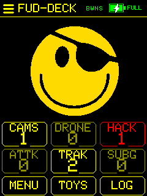
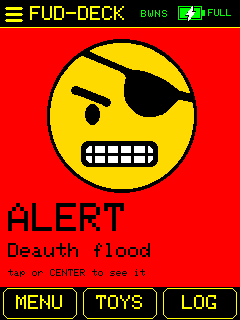
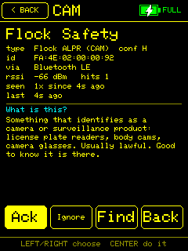
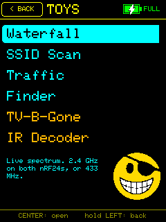
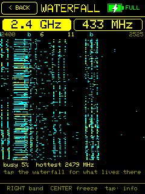
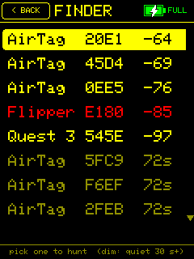
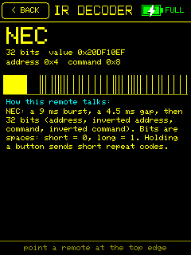
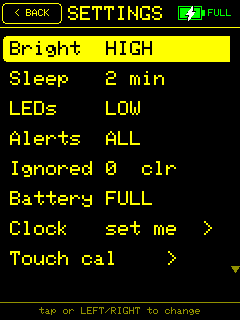
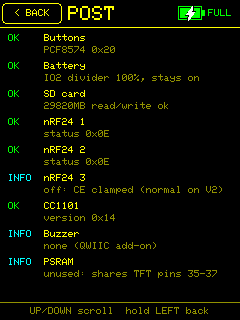

# FUD-Deck



FUD-Deck is counter-surveillance firmware with a face. It listens for trackers, hidden
cameras, drones, hacker tools, sub-GHz activity and Wi-Fi attacks, explains what it hears, and
logs it to an SD card. It is part of the FUD (Find Unwelcome Devices) family by thoughtfix,
alongside [FUD](https://github.com/thoughtfix/FUD-Firmware) and
[FUD-X3](https://github.com/thoughtfix/FUD-X3).

FUD-Deck runs on small touchscreen ESP32 boards. The first is the **ESP32-DIV V2 hardware**.
FUD-Deck is not related to the ESP32-DIV firmware and shares no code with it. Cheap Yellow
Display (CYD) boards and the Cardputer-ADV are planned.

**It only listens, by default.** No attack modes or broadcasts are enabled by default: its
Bluetooth and Wi-Fi scans are passive and never send a scan request or a probe. The one thing it
sends is the TV-B-Gone toy (infrared), fired by hand.

## Before you plug in a battery

Read [Will the ESP32-DIV V2 burn my house down?](docs/ESP32-DIV_V2_Power/ESP32-DIV_V2_Power.md)
The short version: the board is no more dangerous than any battery gadget, but it has no
protection against a battery plugged in backwards, and one of the "+" marks by the jack is
misleading. Check with a meter first, and use a protected LiPo.

## Meet Zuse

Zuse is the face of the device. He shows the mood: calm when all is quiet, curious, worried,
angry when something is attacking. Now and then he glances around, winks, spins or sweeps a
radar across his face.

Under him, six tiles count what each group holds right now. Tap one to see the list. A red
tile is an attack or hacker tool you have not acknowledged yet; it stays red until you do.

The header shows `B W N S` in green for the radios listening right now (Bluetooth, Wi-Fi,
nRF24 at 2.4 GHz, sub-GHz), and the battery, green with a bolt on USB. The bottom bar opens
MENU, TOYS and LOG.

## What Zuse looks for

| Tile | What it means |
|---|---|
| CAMS | cameras, plate readers, body cams, camera glasses and headsets, gunshot sensors |
| DRONE | drones: Remote ID broadcasts and known makers |
| HACK | hacker tools: Flipper Zero, Wi-Fi Pineapple, deauthers |
| ATTK | Wi-Fi attacks: deauth floods, evil twins, 2.4 GHz jammers |
| TRAK | trackers with you now: AirTags, Tiles, SmartTags, Chipolos and others |
| SUBG | sub-GHz activity on 433 MHz |

AirTags change address every few minutes, so they show as one bundled row. A tracker only
counts as **following you** once it has stayed with you while the Wi-Fi networks around you
changed, that is, after you moved. Sitting at home with the neighbours' AirTags does not set
it off.

### Alerts



An attack or hacker tool turns the screen red and the LEDs pulse. Tap or press CENTER to see
it; opening it acknowledges it. After 30 seconds the alert steps aside and leaves the tile red
(after 10 seconds for anything found while starting up, like your own Flipper). Other finds are
quieter: Zuse reacts and the LEDs flash the category colour.

### A detection



Open any row for what it is, how strong the signal is, how many times it has turned up this
boot ("seen 2x since 25m ago") and what that kind of device does.

- **Ack:** you have seen it. It stays in the list, dimmed.
- **Ignore:** never show this one again (saved). Settings > Ignored clears the list.
- **Find:** walk toward it with the Finder.

In lists, red means it needs a look and dim means acknowledged.

## Controls

| | D-pad | Touch |
|---|---|---|
| Move | UP / DOWN | tap a row |
| Open, choose | CENTER or RIGHT | tap |
| Back | hold LEFT | BACK at the top left |
| From Home | CENTER: groups (or the alert), UP: log, DOWN or RIGHT: menu | tiles, Zuse, bottom bar, the menu icon for Settings |

Settings > Button test shows each D-pad press.

## Toys



| Toy | |
|---|---|
| **Waterfall** | a live scrolling spectrum: 2.4 GHz on both nRF24 radios, or 433 MHz on the CC1101. Tap it for what lives where. |
| **SSID Scan** | Wi-Fi networks around you, strongest first, with channel and signal. |
| **Traffic** | how busy 2.4 GHz is over time, low half against high half. |
| **Finder** | pick a tracker, camera or device and follow the hotter / colder meter. Only things heard in the last 30 seconds can be hunted; older ones are dimmed. |
| **TV-B-Gone** | power codes for the common TV brands, through the IR LED. It toggles power, so a TV that is off may turn on. |
| **IR Decoder** | point a remote at the board: protocol, address, command, and the pulses themselves. |

  

The radios a toy does not need are switched off while it runs.

## Settings



| | |
|---|---|
| Bright, Sleep | screen brightness, and how long until it dims and turns off |
| LEDs | LED brightness |
| Alerts | which confidence levels alert: all, or only the surer ones |
| Mute | silence alerts (needs a QWIIC buzzer) |
| Ignored | how many devices you ignored; clear the list |
| Battery | FULL: all radios at once. SAVER: the radios take turns. |
| Clock | set the date, time and zone. "set me" means it is only guessed after a power cut. |
| Touch cal, Button test | check the screen and the D-pad |
| SD log | log every detection to the card |
| POST report, About | the boot check again, and credits |

## Logging

With a FAT32 card in, every detection is written as one CSV line (the FUD-X3 format):
`timestamp,category,label,name,mac,rssi,conf,radio`. With the clock set you get one file per
day (`/.fuddeck/20261113.csv`) with real times. Without it, one file per boot, stamped in
seconds since boot (`+123s`). A device that leaves and comes back gets a new line each time.

## Build and flash

Releases have two files per board. For the ESP32-DIV V2 hardware:

- `fud-deck-div2-<version>.bin`: the full image, for a first install, at offset `0x0`. It
  replaces the stock firmware and clears saved settings.
- `fud-deck-div2-<version>-app.bin`: the app only, for updating a board already on FUD-Deck,
  at `0x10000`.

Use the right-hand USB-C port. With [esptool](https://github.com/espressif/esptool) (replace
the port with yours):

1. Back up the stock firmware first:

   ```
   esptool --chip esp32s3 --port /dev/cu.usbmodem1101 read-flash 0 0x1000000 backup-stock-16mb.bin
   ```

2. Write the full image:

   ```
   esptool --chip esp32s3 --port /dev/cu.usbmodem1101 write-flash 0x0 fud-deck-div2-v0.6b.bin
   ```

If it will not connect, hold BOOT, tap RESET, release BOOT, and try again. To go back to
stock, write your backup with `write-flash 0x0 backup-stock-16mb.bin`.

Turn the power switch on: the board checks its own hardware (POST), then shows Home.



POST lists every part with OK, INFO or a problem. "nRF24 3: CE clamped" is normal on V2
boards: the third radio is wired to the IR LED driver, so FUD-Deck runs on two.

**From source:** with [PlatformIO](https://platformio.org/), from `firmware/`:

```
pio run -e div2 -t upload
```

`tools/release_bin.sh` builds both release files into `dist/`.

## Hardware notes

- MCU: ESP32-S3 (16 MB flash). Its PSRAM shares pins with the display on V2, so it is unused.
- Display: ILI9341, 240 x 320, with XPT2046 touch.
- Radios: two usable nRF24s (2.4 GHz), a CC1101 (433 MHz), and the ESP32's own Wi-Fi and BLE.
- Input: a five-way D-pad on a PCF8574 I/O expander.
- Power: IP5306 charger. **It restarts when USB is unplugged**, a limit of the V2's power
  circuit. It charges with the power switch off, and there is no charge light.
- Some SD cards block every radio on V2 boards, and the shield needs care with SD writes.
  FUD-Deck works around both.

The full list, with what the firmware works around: [docs/hardware-notes.md](docs/hardware-notes.md).

## For developers

- [Tools](docs/tools.md): the dev build's serial remote, screenshots, the probe firmware, the face tools
- [Hardware notes](docs/hardware-notes.md): ESP32-DIV V2 quirks for firmware writers
- [For developers](docs/for-developers.md): flash and RAM budget, radio etiquette for forks
- [Zuse's faces](firmware/tools/facevec/README.md): vector faces, and how to add your own
- [Backport to FUD](docs/backport-to-fud.md): changes that belong in the other FUD releases

Pins live in one file per board (`firmware/src/board/boards/`), one line each, so a new board
is a new pin file and a new build env.

## Attributions and thanks

FUD-Deck is FUD, by thoughtfix, on new hardware: Zuse, his faces, the alert tiers and moods
all come from FUD.

FUD was inspired by [SquachWatch-CYD](https://github.com/skizzophrenic/SquachWatch-CYD). While
it is not the exclusive source of unwanted device identifiers, this code contains a subset of
Talking Sasquach's [signature collection](https://github.com/skizzophrenic/SquachWatch-CYD/blob/master/src/signatures.cpp)
and confidence grades, and we have adopted his chosen GPLv3 license to uphold that credit. The
idea of a clock that is honest about being set, trusted or guessed also comes from
SquachWatch-CYD. The TV-B-Gone toy is a tribute to the original by Mitch Altman and Cornfield
Electronics; the IR power codes are public values sent through IRremoteESP8266.

- Hardware: ESP32-DIV V2 by CiferTech. Only its published schematics were used as a starting
  point; every pin was re-measured.
- Libraries: [LovyanGFX](https://github.com/lovyan03/LovyanGFX),
  [NimBLE-Arduino](https://github.com/h2zero/NimBLE-Arduino) by h2zero,
  [IRremoteESP8266](https://github.com/crankyoldgit/IRremoteESP8266) by crankyoldgit, and
  [PlatformIO](https://platformio.org/) with the Espressif Arduino core.

Signature data traces back to public registries: the IEEE OUI registry, the Bluetooth SIG
assigned numbers and ASTM F3411 / Open Drone ID. Everything taken whole from another project
is listed in [THIRD-PARTY.md](THIRD-PARTY.md).

## Responsible use

FUD-Deck listens by default and never attacks, but it is still a radio monitoring tool. Use it
lawfully and respectfully. See [DISCLAIMERS.md](DISCLAIMERS.md).

## AI disclosure

See [AI_DISCLOSURE.md](AI_DISCLOSURE.md).

## License

Copyright (C) 2026 thoughtfix.

FUD-Deck is released under the [GNU General Public License v3.0](LICENSE), the same license as
FUD. Use it, study it, change it, and share it, but keep derivatives open under the same terms.
