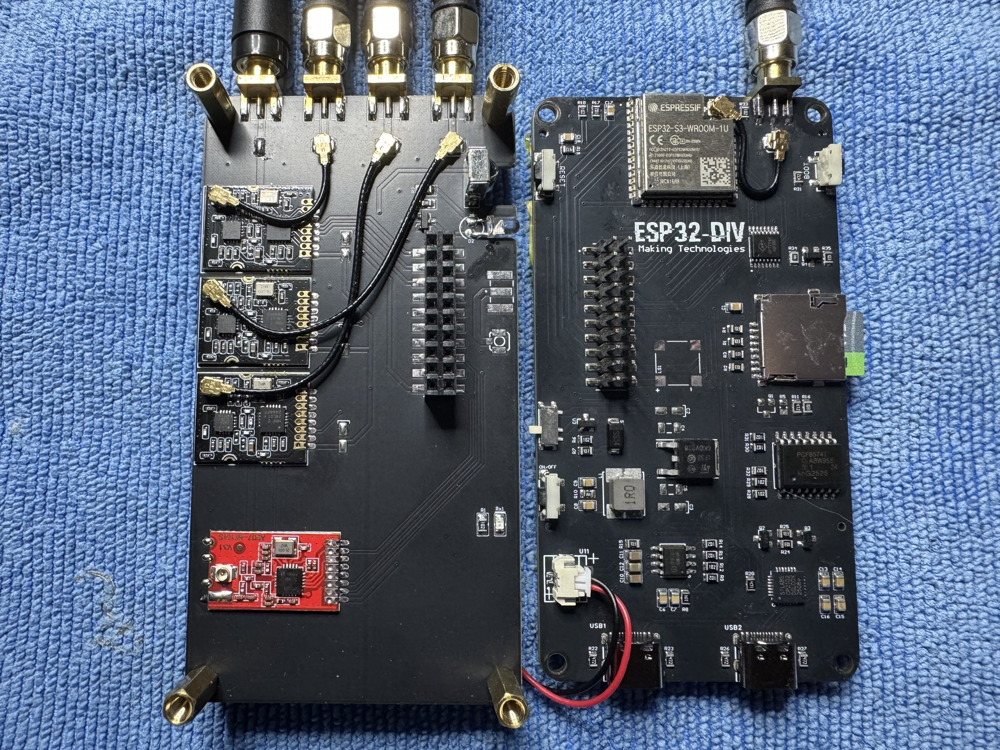
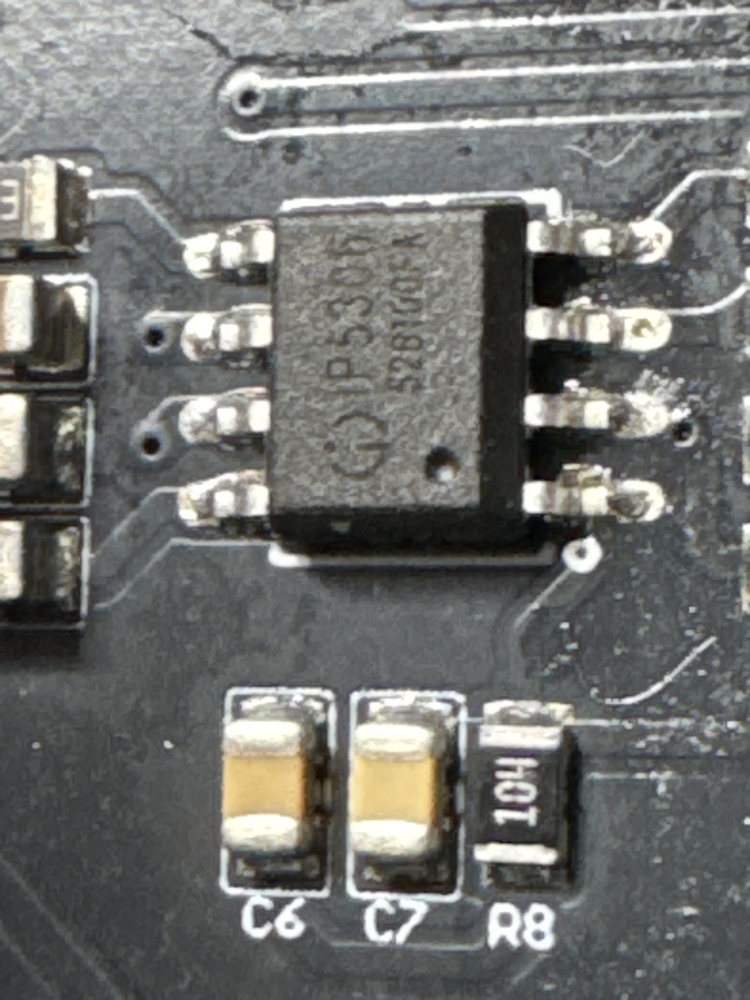
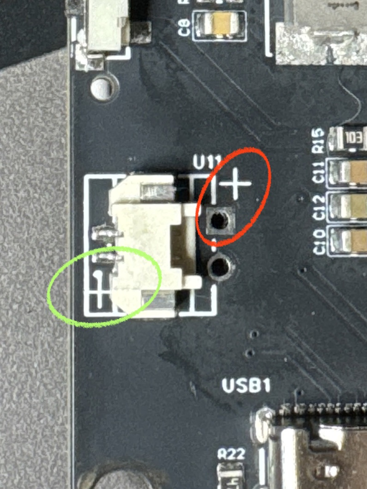

# Will the ESP32-DIV V2 burn my house down?

Short answer: no more than any other battery-powered gadget, **if the battery goes in the right
way round**. That one is on you, and this page shows how to check it.

This is an informal look at one board (bought from Maker Shed), its published schematic, and
the public bug reports. It is not a formal safety test.

*The radio shield (left) and the main board (right). The battery plugs into the white jack at
the bottom of the main board.*

## Where the fear comes from

Some community posts called V2 kits fire hazards. We looked for the fire:

- **No fire or swollen-battery report** for the V2 in [the project's GitHub
  issues](https://github.com/cifertech/ESP32-DIV/issues). Most battery complaints are about
  the battery percentage being wrong, which is a firmware and sensing problem, not a safety
  one.
- One issue is titled "No longer turns on / extremely hot" (#245). It does not say which
  hardware version.
- Several issues are about boards from AliExpress with missing or badly fitted parts (#102,
  #150). That is a seller problem, not a design problem, but it matters. See below.

## What actually charges the battery

A mainstream charger chip, the **IP5306**, the same family used in many power banks and
M5Stack devices. It stops charging at 4.2 V, cuts back when the USB supply sags, and shuts
itself down if it gets too hot ([datasheet](https://electrokit.com/upload/quick/12/91/662c_IP5306.pdf)).

*The IP5306 on our board. Clean joints, no bridges. Look at yours for the same.*

## The one real hazard: battery polarity

- The battery jack has **no protection against a reversed battery** and no fuse.
- There are **two "+" marks by the jack**, at opposite ends. The one beside the two holes (red
  below) labels the hole it lines up with, which really is +. But the jack contact at that end
  is ground. The jack's own "+" (green below) is at the other end, by its pins. Read the red
  one as the jack's polarity and you get it backwards.
- Battery plugs with the same connector (JST-PH) are **not wired the same way by every
  vendor**. A plug that fits can still be reversed.

*Red: the "+" for the hole it lines up with. Green: the jack's own "+", at the opposite end.
Wire the battery by the green one.*

**Before you plug in any battery, check it:**

1. With a meter on the battery's plug, find its + wire: red probe on it, black on the other,
   and the meter reads a positive voltage (about 3.7 to 4.2 V).
2. Hold the plug up to the jack. That + wire must land at the end with the jack's own "+"
   (green in the photo), not the end with the "+" by the holes (red).
3. If it does not, do not plug it in. Get a battery wired the other way, or have someone
   swap the pins in the plug.

## Use a protected battery

The board has no protection circuit of its own for the cell. Use a LiPo with a **built-in
protection board** (the small PCB under the tape at the wire end). It stops over-charge,
over-discharge and short circuits at the cell itself.

The charger can push up to 2.1 A, so a bigger cell is gentler: around 2000 mAh or more.

## Inspect boards from drop-ship sellers

Boards from Tindie, AliExpress and other drop-ship sellers vary. Before the first charge:

- Look at the charger chip (photo above): no solder bridges between pins, no burnt spots, no
  missing parts nearby.
- Check the battery polarity with a meter, as above.
- Charge the first time where you can watch it, and feel the board and battery now and then.
  Warm is normal. Too hot to keep a finger on is not: unplug it.
- A puffy, swollen battery goes in the bin (at a battery recycling point), never back in the
  device.

## Good to know

- **It charges with the power switch off.** The switch only cuts power to the electronics.
- **There is no charge light.** The charger's LED pins are used for its data connection on
  this board. Turn it on to see the battery icon.
- **It restarts when USB is unplugged.** The power briefly drops out while it switches to the
  battery. Annoying, not dangerous.
- **A plugged-in battery drains slowly with the switch off**: about 0.3 mA, calculated from the
  battery-sensing resistors on our board (not measured). That empties a 1000 mAh battery in
  about 4 months. Unplug the battery for long storage.

## Not tested

- Heat with everything running and charging at once.
- Current draw: none of the figures on this page were measured with a meter.
- Other sellers' boards and other production batches.

## Links

- [ESP32-DIV schematics](https://github.com/cifertech/ESP32-DIV/tree/main/Schematic) (CiferTech)
- [ESP32-DIV issues](https://github.com/cifertech/ESP32-DIV/issues)
- [IP5306 datasheet](https://electrokit.com/upload/quick/12/91/662c_IP5306.pdf)
- More board quirks for developers: [hardware notes](../hardware-notes.md)
